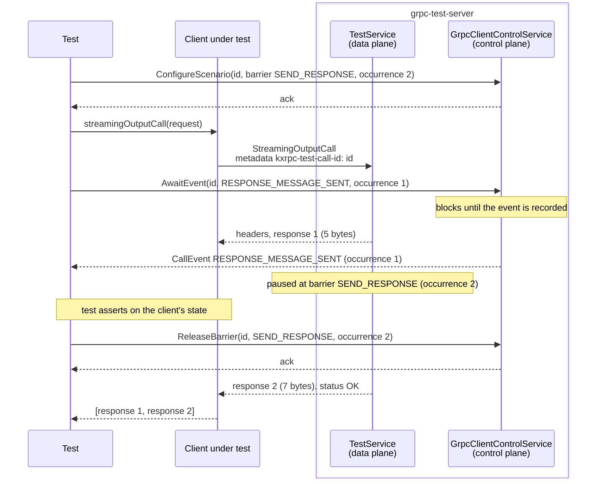
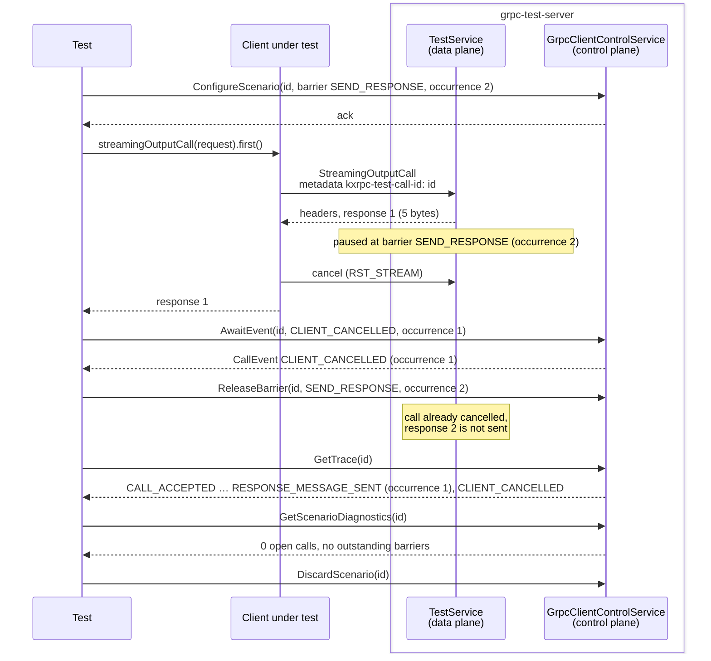

# grpc-test-server

A standalone grpc-java server for the gRPC client tests of kotlinx-rpc. The reference behavior comes from
grpc-java, not from the kotlinx-rpc server. A test can also control the server side of a call
deterministically:

- Pause the call at chosen points.
- Change how the call ends.
- Read what the server observed.

The server listens on `127.0.0.1` on the port from its first argument. When it accepts calls, it prints this line:

```
[GRPC-TEST-SERVER] Server started on 127.0.0.1:<port>
```

## Running

A test task opts in with `withGrpcClientTestServer()` (`gradle-conventions/.../util/grpc/grpcClientTestServer.kt`):

```kotlin
tasks.withType<AbstractTestTask>().configureEach {
    withGrpcClientTestServer()
}
```

All these tasks share one server process:

1. `:tests:grpc-test-server:installDist` installs the server.
2. The server starts before the first task that opts in.
3. The server stops when the build finishes.

Gradle chooses a free port for each start, passes it to the server, and gives it to the test task in the
environment variable `GRPC_TEST_SERVER_PORT`. In the tests, use `grpcTestServerPort`.

A task fails if the server can't start or exits while the task runs.

To start the server by hand, for example for a test binary that runs outside Gradle:

```bash
./gradlew :tests:grpc-test-server:installDist
tests/grpc-test-server/build/install/grpc-test-server/bin/grpc-test-server 50051
```

The tests read the port from `GRPC_TEST_SERVER_PORT`, so set it to the same value.

The tests of the server itself run with `./gradlew :tests:grpc-test-server:test`.

## Services

The client tests and the server share all protos in `tests/test-protos/src/commonMain/proto`.

Most tests use the gRPC **interop** service. The gRPC
[interoperability tests](https://github.com/grpc/grpc/blob/master/doc/interop-test-descriptions.md) define a
standard service, `grpc.testing.TestService`, and a set of test cases for it. Each gRPC implementation
(C++, Java, Go, Swift, and others) has a server and a client for it, and a test can check any client
against any server. This server implements the same service. So the client tests use calls with an exact
specification: empty, unary, and all streaming kinds, with requested sizes, delays, and statuses.

| Service                                    | Proto                                 | Purpose                                                                                                        |
|--------------------------------------------|---------------------------------------|----------------------------------------------------------------------------------------------------------------|
| `EchoService`, `GreeterService`            | `echo_grpc.proto`, `helloworld_grpc.proto` | Simple services for the `grpc-core` tests.                                                                |
| `grpc.testing.TestService`                 | `grpc/testing/test.proto` (vendored)  | The official gRPC interop service, like grpc-java's `TestServiceImpl`. `UnimplementedCall` and `UnimplementedService` return `UNIMPLEMENTED`. |
| `kxrpc.testing.MalformedResponseService`   | `kxrpc/testing/client_control.proto`  | Answers a unary or client-streaming call with zero or two responses. A conforming server can't do this.        |
| `kxrpc.testing.GrpcClientControlService`   | `kxrpc/testing/client_control.proto`  | The tests call it to set up, drive, and inspect scenarios (see [Scenarios](#scenarios)).                      |

A `TestService` call without scenario metadata behaves exactly like a call to the grpc-java interop server.
A `MalformedResponseService` call needs a scenario that sets `malformed_response_cardinality`. Without it,
the call fails with `INVALID_ARGUMENT`.

## Scenarios

### Data-plane and control-plane calls

A test sends two kinds of gRPC calls to the server. Both go to `127.0.0.1:<port>`, except data-plane calls
to a disposable endpoint.

- **Data-plane calls**: the calls under test. The kotlinx-rpc client code under test calls `TestService` or
  `MalformedResponseService`, for example `testService.unaryCall(request)`.
- **Control-plane calls**: the test itself calls `GrpcClientControlService` through a separate client. These
  calls prepare and observe a data-plane call. The client under test never sees them.

A **scenario** connects the two. It is server-side state that the test registers under a call ID of its
choice, the `call_id`. A data-plane call opts into the scenario with the ASCII request metadata
`kxrpc-test-call-id: <call_id>`. The server then handles that call as the scenario describes and records
each step of it.

### Control-plane methods

Each method of `GrpcClientControlService` takes the `call_id` of the scenario that it acts on.

| Method                                              | What it does                                                                                                                                                             |
|-----------------------------------------------------|--------------------------------------------------------------------------------------------------------------------------------------------------------------------------|
| `ConfigureScenario`                                 | Registers a scenario and its configuration (see [What a scenario can configure](#what-a-scenario-can-configure)). Call it before the data-plane call starts. A `call_id` accepts one configuration only. |
| `AwaitEvent`                                        | Blocks until the server records the requested event of the scenario, for example the second `RESPONSE_MESSAGE_SENT`, and returns it. A test uses it to wait until the call reaches a given point. |
| `ReleaseBarrier`                                    | Releases one barrier of the scenario, so a data-plane call paused at it continues.                                                                                      |
| `GrantInboundDemand`                                | For a scenario with manual inbound demand: lets the server read the given number of additional request messages. Until then, the requests stay unread, so a test can check how the client handles backpressure. Needs an active data-plane call. |
| `GetTrace`                                          | Returns the call trace: all events recorded for the scenario so far, in order.                                                                                          |
| `GetScenarioDiagnostics`                            | Returns the number of open data-plane calls, the barriers that aren't released, and the number of blocked `AwaitEvent` calls. A test uses it to check that it left no open call, barrier, or wait. |
| `StartDisposableEndpoint`, `StopDisposableEndpoint` | Start: opens a separate listener for the scenario on a free port of `127.0.0.1` and returns the port. The listener serves only `TestService`. Stop: resets all TCP connections of the listener, which simulates a lost connection, and closes it. |
| `DiscardScenario`                                   | Removes the scenario and stops its disposable endpoint. Calls that still wait on the scenario fail: `AwaitEvent` calls and data-plane calls paused at a barrier.         |

A typical test has these steps:

1. Call `ConfigureScenario`.
2. Start the data-plane call with the `kxrpc-test-call-id` metadata.
3. While the call runs, synchronize with the server through `AwaitEvent`, `ReleaseBarrier`, and `GrantInboundDemand`.
4. After the call, check what the server observed with `GetTrace` and `GetScenarioDiagnostics`.
5. Call `DiscardScenario`.

### What a scenario can configure

| Field of `ConfigureScenarioRequest`     | Effect                                                                                                   |
|-----------------------------------------|----------------------------------------------------------------------------------------------------------|
| `barriers`                              | Points where the call pauses until the test calls `ReleaseBarrier`. See the barrier types below.        |
| `initial_metadata`, `trailing_metadata` | Entries that the server adds to the response headers and trailers, in order and with duplicate keys.    |
| `terminal_behavior`                     | Closes the call early with a given status. See the terminal stages below.                               |
| `flow_control.manual_inbound_demand`    | The server reads request messages only after `GrantInboundDemand`. Only for the request-streaming methods of `TestService`. |
| `flow_control.respect_response_readiness` | The server holds back responses while the client isn't ready to receive them. Only for the streaming-response methods of `TestService`. |
| `malformed_response_cardinality`        | `OMIT_RESPONSE` (zero responses) or `DUPLICATE_RESPONSE` (two responses) for `MalformedResponseService`. |

A barrier is a point in the server's handling of the call where the call pauses until the test calls
`ReleaseBarrier`. Each barrier has a type and a one-based occurrence:

| Barrier type                | The call pauses before                                                     | Occurrence counts                         |
|-----------------------------|----------------------------------------------------------------------------|-------------------------------------------|
| `SEND_INITIAL_HEADERS`      | The server sends the initial headers. A trailers-only close skips it.      | A call reaches only occurrence 1.         |
| `SEND_RESPONSE`             | The server sends a response message.                                       | The response messages of the call.        |
| `CLOSE_CALL`                | The server closes the call, also for a close from `terminal_behavior` or a server failure. | A call reaches only occurrence 1. |
| `DELIVER_REQUEST_MESSAGE`   | The service gets a received request message.                               | The `REQUEST_MESSAGE_RECEIVED` events.    |
| `DELIVER_CLIENT_HALF_CLOSE` | The service gets the client's half-close.                                  | The `CLIENT_HALF_CLOSED` events.          |

For example, `SEND_RESPONSE` occurrence 2 pauses the call right before its second response. A released
barrier stays released, so a call that reaches it later doesn't pause. Barriers make races reproducible,
for example a cancellation exactly between two responses.

`terminal_behavior` closes the call with its `status` and the configured trailers at one of these stages:

- `BEFORE_INITIAL_METADATA`: before the service starts, without headers or responses.
- `AFTER_INITIAL_METADATA`: after the initial headers, before the first response.
- `AFTER_RESPONSE_MESSAGES`: after `response_message_count` responses. If the service completes before that
  count, the call fails with `INTERNAL`.
- `AFTER_SERVICE_COMPLETION`: after the service completes, with this status instead of the service's own status.

### Events

The server records each step of a scenario's data-plane call as a `CallEvent`:

- Steps of the call: `CALL_ACCEPTED`, `REQUEST_MESSAGE_RECEIVED`, `CLIENT_HALF_CLOSED`,
  `INITIAL_HEADERS_SENT`, `RESPONSE_MESSAGE_SENT`.
- End of the call, exactly one of: `CALL_CLOSED`, `CLIENT_CANCELLED`.
- Response readiness: `RESPONSE_DELIVERY_BLOCKED`, `RESPONSE_DELIVERY_READY`.

Each event has a one-based occurrence for each type, and `AwaitEvent` selects an event by its type and
occurrence. `client_control.proto` describes each event type and the data that it has.

### Errors

| Status                | Cause                                                                                                                                                           |
|-----------------------|-----------------------------------------------------------------------------------------------------------------------------------------------------------------|
| `NOT_FOUND`           | A control-plane call or a data-plane call has an unknown `call_id`.                                                                                             |
| `INVALID_ARGUMENT`    | The configuration or another control-plane request isn't valid. A data-plane call has more than one or a blank `kxrpc-test-call-id` value.                       |
| `FAILED_PRECONDITION` | The call isn't valid in the current scenario state. For example, the `call_id` already has a configuration, the barrier isn't configured or is already released, or the test discarded the scenario. |
| `DEADLINE_EXCEEDED`   | An `AwaitEvent` call or a call paused at a barrier waited for 10 seconds, so a broken test can't block the server.                                            |

## Examples

The examples use the kotlinx-rpc client:

- `control`: the control-plane `GrpcClientControlService` client.
- `testService`: the data-plane `TestService` client. It adds `kxrpc-test-call-id: <id>` to each call, for
  example with a `GrpcClientInterceptor` that adds it to `requestHeaders`.

Both examples use this streaming request. It asks the server for two responses of 5 and 7 bytes:

```kotlin
val request = StreamingOutputCallRequest {
    responseParameters = listOf(ResponseParameters { size = 5 }, ResponseParameters { size = 7 })
}
```

### Holding a response at a barrier

This example checks the client after the server sent the first response and before it sends the second:

```kotlin
control.configureScenario(ConfigureScenarioRequest {
    callId = id
    barriers = listOf(Barrier { type = BarrierType.SEND_RESPONSE; occurrence = 2u })
})

val responses = async { testService.streamingOutputCall(request).toList() }

// Returns once the server has sent the first response; it is now paused before the second one.
control.awaitEvent(AwaitEventRequest { callId = id; event = EventType.RESPONSE_MESSAGE_SENT; occurrence = 1u })
// ... assert on the client's state here ...
control.releaseBarrier(ReleaseBarrierRequest { callId = id; barrier = BarrierType.SEND_RESPONSE; occurrence = 2u })

assertEquals(2, responses.await().size)
```



### Checking that a cancellation reached the server

A client that stops the collection of a response stream must also cancel the call on the server. The
same barrier keeps the call open after the first response, so the cancellation can't race with a normal
completion. The call trace then shows what the server observed:

```kotlin
control.configureScenario(ConfigureScenarioRequest {
    callId = id
    barriers = listOf(Barrier { type = BarrierType.SEND_RESPONSE; occurrence = 2u })
})

// Takes the first response and stops collecting, which must cancel the call.
testService.streamingOutputCall(request).first()

// The cancellation reaches the server asynchronously, so wait for it.
control.awaitEvent(AwaitEventRequest { callId = id; event = EventType.CLIENT_CANCELLED; occurrence = 1u })
control.releaseBarrier(ReleaseBarrierRequest { callId = id; barrier = BarrierType.SEND_RESPONSE; occurrence = 2u })

val trace = control.getTrace(GetTraceRequest { callId = id })
assertEquals(EventType.CLIENT_CANCELLED, trace.events.last().type)

val diagnostics = control.getScenarioDiagnostics(GetScenarioDiagnosticsRequest { callId = id })
assertEquals(0u, diagnostics.activeCallCount)
assertEquals(emptyList(), diagnostics.outstandingBarriers)

control.discardScenario(DiscardScenarioRequest { callId = id })
```



## Code map

| File                             | Role                                                                          |
|----------------------------------|-------------------------------------------------------------------------------|
| `TestServer.kt`                  | Entry point. Starts all services on `127.0.0.1:<port>`.                           |
| `CallScenarioRegistry.kt`        | Scenario state: configuration, call trace, barriers, inbound demand, diagnostics. |
| `ScenarioInterceptor.kt`         | Applies a scenario to calls with `kxrpc-test-call-id` and records their events. |
| `ScenarioStatus.kt`              | Maps scenario failures to the gRPC status codes in [Errors](#errors).          |
| `InteropTestService.kt`          | The interop `TestService`. Sends streaming responses at the requested intervals. |
| `ManualInboundDemand.kt`         | Manual inbound demand: the server reads requests only as the test grants demand. |
| `ResponseReadinessGate.kt`       | Response readiness: holds back responses while the client isn't ready.        |
| `MalformedResponseTestService.kt`| Raw handlers that send zero or two responses.                                 |
| `GrpcClientControlService.kt`    | The control-plane RPCs.                                                       |
| `EchoServiceImpl.kt`, `GreeterServiceImpl.kt` | `EchoService` and `GreeterService`.                              |
| `DisposableEndpointManager.kt`, `ResettingTcpProxy.kt` | Disposable endpoints: listeners for one scenario whose connections the test can reset. |
